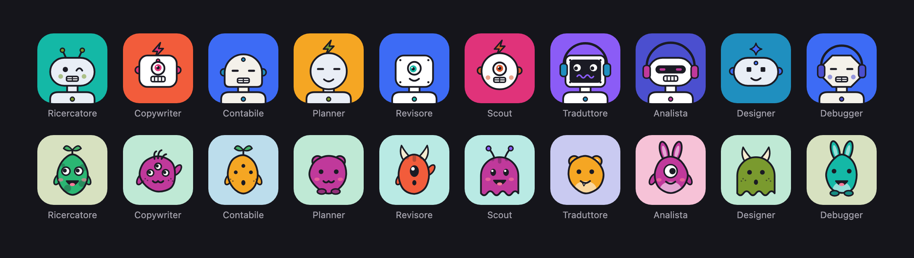

# Icone agenti

**Un nome, un'icona. Sempre la stessa.**

Scrivi il nome di un agente AI e ottieni il suo avatar: un robottino o una creaturina, con colori, forma, occhi e accessori ricavati dal nome. Niente database, niente upload, niente immagini salvate: lo stesso nome produce sempre la stessa icona, su qualsiasi computer.



## Cosa fa

- **Due stili.** *Robot*: 6 teste, 8 tipi di occhi, antenne, cuffie, visori. *Creature*: corpi morbidi generati dall'hash (non esistono due sagome uguali), orecchie, corna, da uno a tre occhi, macchie e strisce.
- **Varianti.** Se l'icona di un nome non ti convince, sfoglia le varianti: restano legate a quel nome.
- **Favicon per ogni dispositivo**, come [RealFaviconGenerator](https://realfavicongenerator.net/): browser, Google, iPhone e Android, con anteprima realistica di ciascuno.
- **Pacchetto pronto** in un unico .zip, con manifest e codice HTML da incollare nel sito.
- **Zero dipendenze.** Le icone sono SVG generati da due funzioni JavaScript che puoi copiare in qualsiasi progetto.

## Provalo

Scarica il repository e apri `index.html` nel browser: non serve installare nulla.

`robot.html` è la prima versione, solo robot, con una squadra di 24 agenti di esempio.

## Il pacchetto favicon

| File | Dove serve |
|---|---|
| `favicon.ico` (16, 32, 48 px) | browser meno recenti, Windows |
| `favicon.svg` | browser moderni, nitida a ogni dimensione |
| `favicon-96x96.png` | browser, risultati di Google |
| `apple-touch-icon.png` (180 px) | schermata Home di iPhone e iPad |
| `web-app-manifest-192x192.png`, `-512x512.png` | Android, web app installate |
| `site.webmanifest` | nome, colori e icone della web app |

Per iPhone e Android l'icona è a pieno quadrato: è il sistema a ritagliarla con gli angoli arrotondati o a cerchio.

## Usare le icone nel tuo codice

```js
// src/robot.js e src/creature.js, nessuna dipendenza
const { svg, traits } = agentAvatar('Ricercatore');
// traits → { Testa: 'Capsula', Occhi: 'Occhiolino', Antenna: 'Doppia', ... }

creatureAvatar('Ricercatore', { shape: 'circle', variant: 2 }).svg;
```

| Opzione | Valori |
|---|---|
| `shape` | `square` (angoli arrotondati, predefinito), `circle`, `full` (quadrato pieno) |
| `variant` | `0` (predefinito), `1`, `2`… |

Il nome viene normalizzato (spazi ai lati e maiuscole non contano), passato in un hash (cyrb53) che inizializza un generatore pseudo-casuale: ogni scelta, dal colore alla bocca, viene da lì.

## Struttura

```
index.html        strumento completo (generato da build.sh)
robot.html        prima versione, solo robot
src/robot.js      agentAvatar()
src/creature.js   creatureAvatar()
src/app.js        pagina: PNG, ICO, manifest, zip
src/head.html     HTML e CSS della pagina
docs/             immagine di anteprima e la pagina che la genera
```

Dopo una modifica in `src/`, esegui `./build.sh` per rigenerare `index.html`.
